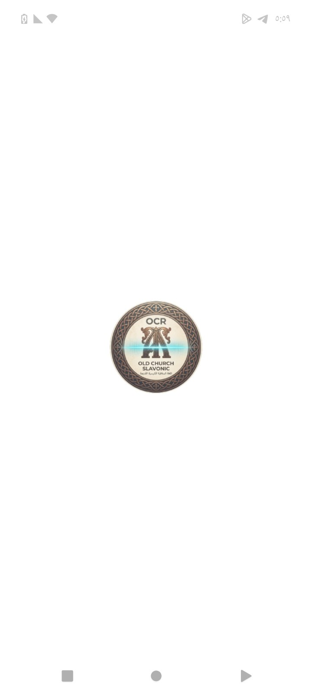
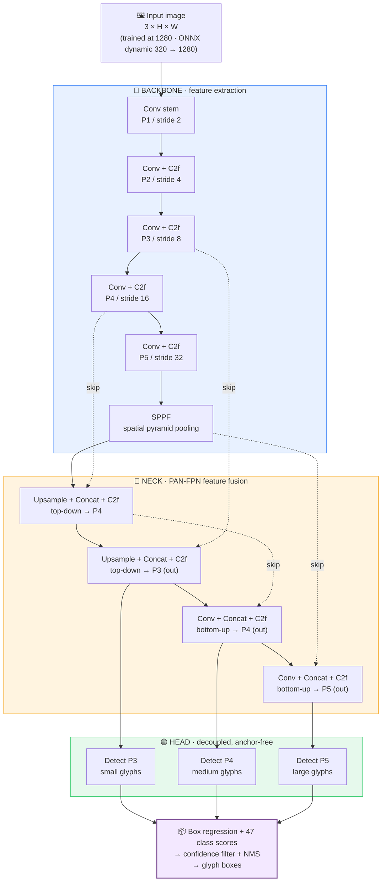
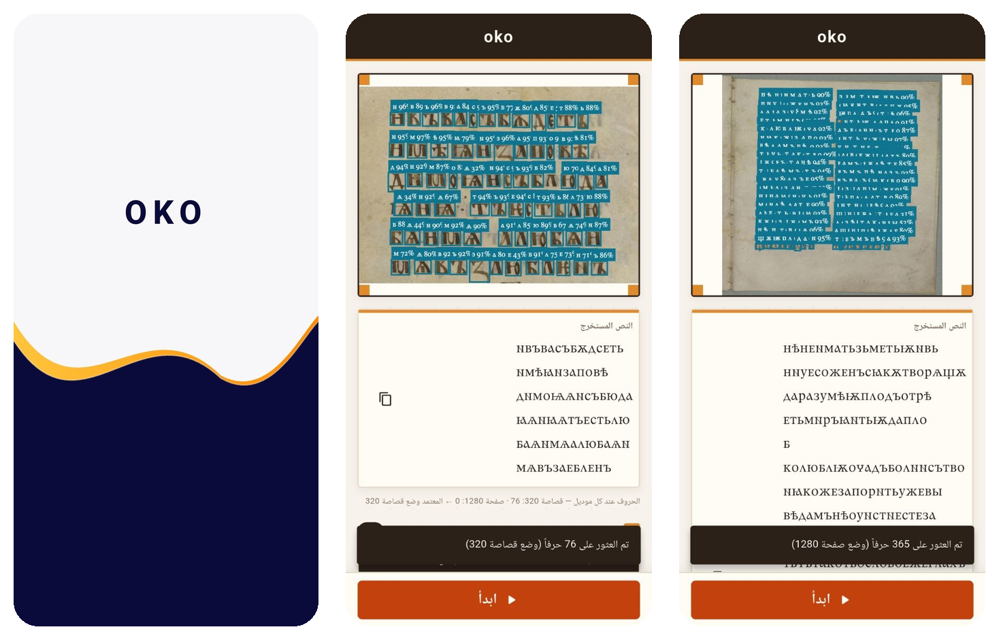
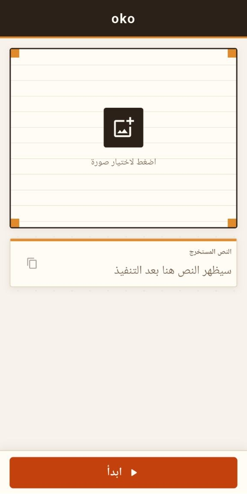
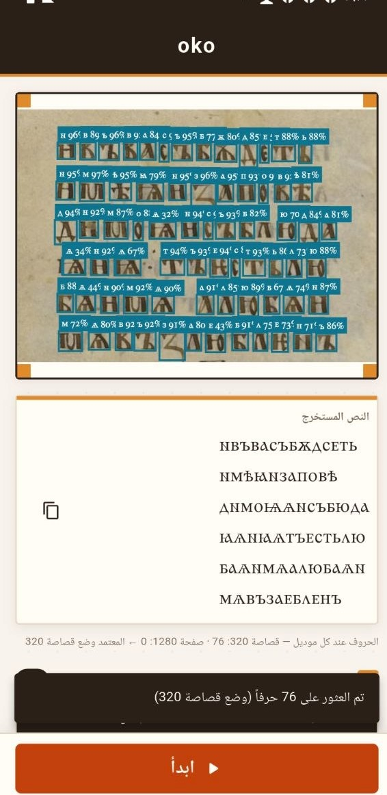
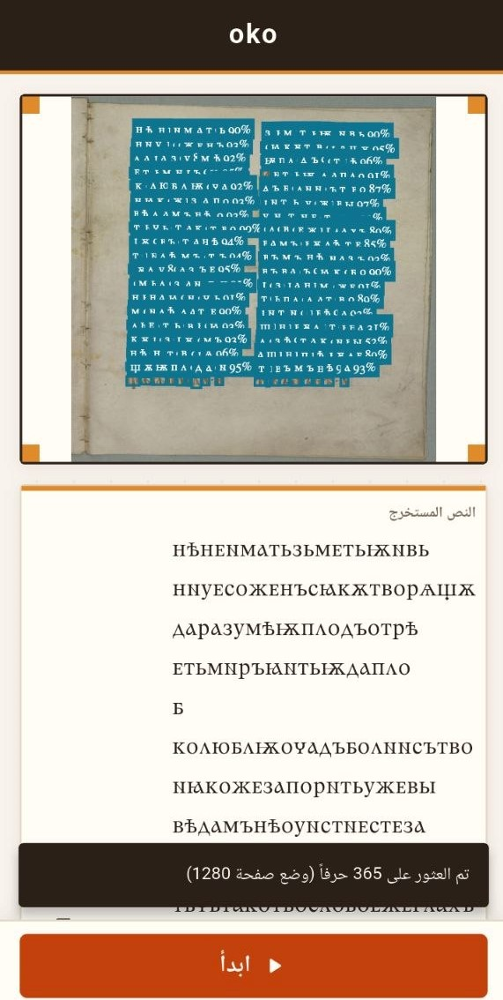
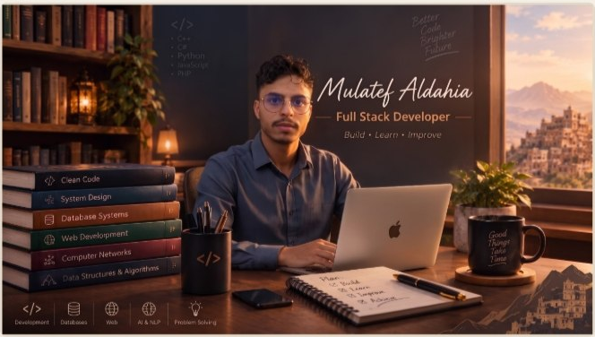
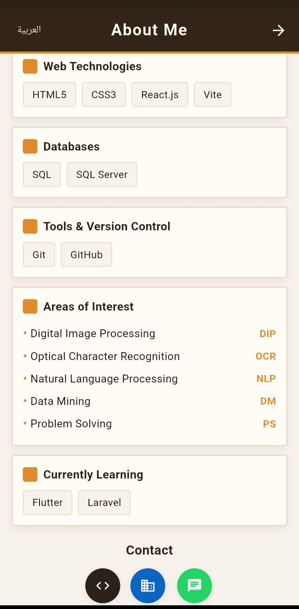

<!-- ============================================================
  TODO BEFORE PUBLISHING (delete this block afterwards)
  1. Split: confirm the real page counts (train 190 / val 24 / test 22 or 23?)
     so that they add up to the 237 total.
  2. State which file is the crop (320) model and which is the page (1280) model:
     oko_model.onnx vs oko_model_1.onnx (and which one is the 12.2 MB file).
  3. Root has no requirements.txt (only training/requirements.txt). Either add one
     or keep the install command below as written.
  4. Python badge says 3.10+ (the .pyc files show 3.10). Update if you really need 3.13.
  5. KlimentStd.ttf must not be in the repo history or inside the released APK
     (its license forbids redistribution). Check .gitignore and the APK.
  6. Run `python evaluation/column_builder.py --help` and make sure the CLI
     arguments in Quick Start match.
============================================================ -->

<div align="center">




**An end-to-end OCR pipeline for Old Church Slavonic manuscripts:**
**glyph detection → column-aware reconstruction → CER evaluation → on-device Android app (OKO).**

<br/>

[](https://github.com/Mulatef-Aldahia/Old-Church-Slavonic-OCR/releases/tag/v1.0.0)
[](docs/EVALUATION.md)
[](LICENSE)


<br/>

[**🎬 Demo**](#-see-it-in-action) ·
[**🧠 Model**](#-model-architecture) ·
[**🏗 System**](#-system-architecture) ·
[**📊 Results**](#-results) ·
[**📱 App**](#-mobile-app-oko) ·
[**🚀 Quick Start**](#-quick-start) ·
[**👨‍💻 Developer**](#-about-the-developer)

</div>

---

<div align="center">

| 📄 **237** | 🔲 **~97.5k** | 🔤 **47** | 🎯 **0.8714** | ⚡ **~79 ms** | 🪶 **6.4 MB** |
|:---:|:---:|:---:|:---:|:---:|:---:|
| annotated pages | glyph boxes | classes | mAP50 (test) | per image, Tesla T4 | `.pt` model size |

</div>

---

## 📜 The Problem

Old Church Slavonic manuscripts written in **Ustav (uncial)** script are cultural treasures, yet general-purpose OCR engines struggle with them because of:

- 🔗 **Touching and overlapping glyphs** (ligatures)
- 🕰 **Faded ink, stains, and degraded parchment**
- 📰 **Two-column layouts** and **titlo** marks (diacritics)

**This project's answer:** treat OCR as *object detection*. Every glyph is located and classified by a fine-tuned **YOLOv8n**, then a **column-aware builder** rebuilds columns, lines, and words in reading order, and a modular **CER** evaluator measures the result.

---

## 🎬 See It in Action

<div align="center">

| ① Detect glyphs | ② Rebuild the text | ③ Measure the error |
|:---:|:---:|:---:|
|  |  |  |
| YOLOv8n finds each character on a two-column page | Columns → Lines → Words (first 15 lines shown) | Substitutions · Deletions · Insertions |

</div>

> **About the CER example:** the report compares a **32-character** reference with its reconstruction: 31 characters correct, 1 deletion, **CER = 3.12%**. It is a single-sample demonstration of the metric, not a score over the whole test set. See [Results](#-results).

📱 **Prefer to try it on a phone?** Jump to the [OKO app](#-mobile-app-oko).

---

## 🧠 Model Architecture

The detector is **YOLOv8n** (nano), fine-tuned on 47 classes (46 characters plus a space entry). It is anchor-free, with a CSP-style backbone, a PAN-FPN neck, and a decoupled head predicting boxes and classes at three scales.



| Property | Value |
|----------|-------|
| Classes | **47** (see [Dataset](#-dataset)) |
| Parameters (training) | **3,020,013** |
| Parameters (after layer fusing) | **3,014,813** |
| PyTorch weights (`.pt`) | **6.4 MB** |
| ONNX model (`.onnx`) | **12.2 MB** |
| ONNX input | dynamic size, **320 → 1280** px |

| Component | Role in this project |
|-----------|----------------------|
| **Backbone** | Extracts glyph features from fine strokes up to whole-letter shapes |
| **Neck (PAN-FPN)** | Mixes fine and coarse features so small titlo marks and large letters are both seen |
| **Decoupled head** | Separate branches for *where* (box) and *what* (class) |
| **Dynamic ONNX** | One export serves phones and high-resolution scans |

> The layout shown is the standard YOLOv8n design. Details: [`docs/MODEL_CARD.md`](docs/MODEL_CARD.md).

---

## 🏗 System Architecture

```mermaid
flowchart LR
    subgraph DATA["📚 DATA · private"]
        D1["📜 237 annotated pages<br/>Roboflow project<br/>char-level boxes"]
        D2["🎨 Synthetic<br/>generation"]
        D3["🛡 Guardrails<br/>no silent class drops"]
        D1 --> D3
        D2 --> D3
    end

    subgraph TRAIN["🏋 TRAINING"]
        T0["Synthetic<br/>pre-training"] --> T1["Real-data<br/>fine-tuning<br/>up to v3"] --> T2["Fine-tune v6<br/>40 epochs · AdamW<br/>1280 px · batch 2 · T4"] --> T3["📦 yolov8n_ocs_<br/>FINAL_v6.pt<br/>(approved)"]
    end

    subgraph EXPORT["📤 EXPORT"]
        E1["export_onnx.py<br/>dynamic 320–1280"] --> E2["✅ Parity check<br/>±0 boxes vs .pt"]
    end

    subgraph PIPE["⚙️ OCR PIPELINE"]
        P1["Detect glyphs"] --> P2["Build<br/>columns"] --> P3["Build<br/>lines"] --> P4["Segment<br/>words"] --> P5["📝 Text"]
    end

    subgraph EVAL["📊 EVALUATION"]
        V1["Levenshtein CER"] --> V2["Substitutions<br/>Deletions<br/>Insertions"]
    end

    subgraph APP["📱 ANDROID · OKO"]
        A1["Flutter app<br/>ONNX on-device<br/>crop 320 / page 1280"]
    end

    D3 --> T0
    T3 --> E1
    T3 --> P1
    E2 --> A1
    P5 --> V1

    style DATA fill:#eef6ff,stroke:#3b82f6
    style TRAIN fill:#fff1f2,stroke:#ef4444
    style EXPORT fill:#fff8e6,stroke:#f59e0b
    style PIPE fill:#f3e8ff,stroke:#7b4b94
    style EVAL fill:#e6f9ec,stroke:#22c55e
    style APP fill:#e0f2fe,stroke:#0284c7
```



### 📐 How the reconstruction works

The builder is **adaptive**: it uses no fixed pixel thresholds, so it adjusts to each page's glyph size and spacing.

| Step | What happens |
|:---:|---|
| **1. Columns** | Glyph centers are grouped along the x-axis to find the page's columns |
| **2. Lines** | Inside each column, boxes with overlapping y-ranges form a line |
| **3. Words** | Gaps between neighboring glyphs, relative to typical spacing, split words |
| **4. Order** | Left column first, lines top to bottom, glyphs left to right |

---

## 🗂 Dataset

| Property | Value |
|----------|-------|
| Pages | **237**, with character-level bounding boxes (~97.5k) |
| Split | **190** train · **24** validation · **22** test |
| Test boxes | 8,982 |
| Annotation platform | Roboflow (private project) |
| Access | **Private.** Not publicly released; available only to authorized users |
| License | No public distribution license at present |

> 🔒 Because the dataset is private, the notebooks and training scripts are reproducible only with your own annotated pages in YOLO format (see `data/real_ocs.yaml`). Trained weights are published in [Releases](https://github.com/Mulatef-Aldahia/Old-Church-Slavonic-OCR/releases).

<details>
<summary><b>🔤 Classes (47)</b></summary>

The reference is [`app/assets/models/v6_names.json`](app/assets/models/v6_names.json). Its first entry is a space character, followed by 46 letters:

`а` `б` `в` `г` `д` `е` `ж` `з` `и` `й` `к` `л` `м` `н` `о` `п` `р` `с` `т` `у` `ф` `х` `ц` `ч` `ш` `щ` `ъ` `ы` `ь` `ю` `я` `і` `ї` `ѡ` `ѣ` `ѧ` `ѩ` `ѫ` `ѭ` `ѯ` `ѱ` `ѳ` `ѵ` `ѿ` `ꙋ` `ꙗ`

</details>

---

## 🏋 Training

| Setting | Value |
|---------|-------|
| Starting point | `yolov8n_ocs_FINAL_v3.pt`, the third model trained on real data |
| Approved release | **`yolov8n_ocs_FINAL_v6.pt`** (fine-tuned after v3) |
| Epochs | 40 |
| Image size | 1280 × 1280 |
| Batch size | 2 |
| Optimizer | AdamW |
| GPU | Tesla T4 (Google Colab) |
| Training time | ≈ 0.338 h (about 20 min 17 s) |
| Notebook | [`notebooks/03_finetune_v6.ipynb`](notebooks/03_finetune_v6.ipynb) |

---

## 📊 Results

**Detection, evaluated on the held-out test split (22 pages · 8,982 boxes)**

| Metric | Score | Target | |
|--------|:---:|:---:|:---:|
| **mAP50** | **0.8714** | ≥ 0.85 | ✅ Met |
| mAP50-95 | 0.8167 | n/a | |
| Precision | 0.9113 | n/a | |
| Recall | 0.8613 | n/a | |
| Speed (Tesla T4) | ~79 ms / image | < 100 ms | ✅ Met |

**Text reconstruction**

| Evaluation | Result |
|------------|:---:|
| Single 32-character sample (1 deletion, 0 substitutions, 0 insertions) | CER **3.12%** |
| Full-page CER over the test set | *planned* |

> The 3.12% figure illustrates how the metric works on one short sample. A full-page evaluation will show how detection recall and reading order affect the final text.

### 🔬 Per-class AP50: strengths and weak spots

```text
BEST                                              CHALLENGING
ѡ  Omega   ███████████████████░  0.9548           а  Az        ██████████████░░░░░░  0.6800
ч  Cherv   ███████████████████░  0.9504           ь  Soft sign █████████████░░░░░░░  0.6489
щ  Shta    ███████████████████░  0.9454           ю  Yu        ███████████░░░░░░░░░  0.5617
ц  Tsi     ███████████████████░  0.9451           ѣ  Yat       ████░░░░░░░░░░░░░░░░  0.2082
```

> The weakest classes have **fewer than 100 training boxes each** and vary a lot with context. Adding examples for them is the clearest path to higher accuracy.

### 🧪 Synthetic-only vs. real-data fine-tuning

| Model | mAP50 |
|-------|:---:|
| YOLOv8n trained on synthetic data only (v0.3) | ≈ 0.68 |
| **YOLOv8n fine-tuned on real pages (v1.0.0)** | **0.8714** |

Full numbers and the per-class CSV: [`docs/EVALUATION.md`](docs/EVALUATION.md) · [`results/per_class_ap_test.csv`](results/per_class_ap_test.csv)

---

## 📱 Mobile App: OKO

**OKO** is a Flutter app for Android that runs the exported ONNX model **on the device**, so no server is needed.

<div align="center">

</div>

**In short:** choose a manuscript image, press **Start (ابدأ)**, and read or copy the extracted text. Full walkthrough: [How to use the app](#-how-to-use-the-app).

**Highlights**

- 🔀 **Two inference modes:** *crop mode (320)* for close-up fragments and *page mode (1280)* for full pages. The app ships **one ONNX model per mode** (`oko_model.onnx` and `oko_model_1.onnx`), and the result screen reports how many characters each found and which one was used.
- 🔤 **Authentic rendering:** the extracted text is displayed with the **Kliment Std** Slavonic font (not included in this repository, see the [Font Notice](#-font-notice)).
- 🌐 Arabic interface and a bilingual (Arabic / English) *About* screen.
- ✅ ONNX output verified against the PyTorch model (**±0 boxes** parity).

**Get it**

- 📥 [**Download the APK**](https://github.com/Mulatef-Aldahia/Old-Church-Slavonic-OCR/releases/latest)
- 🛠 Or build from source. First download **KlimentStd.ttf** from its [official source](https://www.kodeks.de/AKSL/Schrift/KlimentStd.htm) and place it at `app/assets/fonts/KlimentStd.ttf` (see the [Font Notice](#-font-notice)), then:

```bash
cd app
flutter pub get
flutter run --release
```

📁 Source: [`app/lib/core`](app/lib/core) · Models: [`app/assets/models`](app/assets/models)

### 📖 How to use the app

<div align="center">

| ① Open | ② Choose an image | ③ Start and read | ④ Full-page result |
|:---:|:---:|:---:|:---:|
|  |  |  |  |
| Launch **OKO** | Tap the framed area | Boxes + extracted text | Works on whole pages too |

</div>

1. **Install.** Download the APK from the [Releases page](https://github.com/Mulatef-Aldahia/Old-Church-Slavonic-OCR/releases/latest) and open it. If Android asks, allow installing from this source.
2. **Launch OKO.** After the splash screen, the main screen appears with an empty image frame.
3. **Choose an image.** Tap the framed area (**اضغط لاختيار صورة**) and pick a photo of a manuscript page or fragment.
4. **Press Start (ابدأ).** Detection runs **on your phone**, with no internet connection.
5. **Check the detections.** The app draws a box and a confidence value on every glyph it found. A message at the bottom tells you how many characters were found and which mode was used (**crop 320** or **page 1280**). A line under the text shows the count for each mode.
6. **Read the text.** The recognized text appears in the **Extracted text (النص المستخرج)** panel, in reading order.
7. **Copy it.** Tap the copy icon next to the panel to copy the whole text, then paste it anywhere.

**Tips for better results**

| Tip | Why |
|-----|-----|
| Photograph the page **straight on**, in even light | Shadows and tilt hide glyph edges |
| Keep the image **sharp** and avoid glare on the parchment | Faded ink is already hard to detect |
| For a few close-up lines, expect **crop mode (320)**; for a whole page, **page mode (1280)** | The app reports which mode it used, as in the screenshots above |
| If the character count looks low, **retake** the photo or crop closer | Detection recall drops on blurry or distant shots |
| Review the text against the image | Rare letters such as ѣ, ю, ь, and а are the weakest classes (see [Results](#-results)) |

> ℹ️ The *About* screen has an **Arabic / English** toggle in its header.

### 📸 Results Gallery

Real screenshots from the app, showing the two inference modes on different inputs.

<div align="center">

| 🔎 Crop mode (320): close-up fragment | 📄 Page mode (1280): full two-column page |
|:---:|:---:|
|  |  |
| **76 characters** found in 6 lines. The page mode found 0 here, so crop mode was used. | **365 characters** found across both columns in page mode. |
| Every glyph gets a box and a confidence value; the text is shown below in Kliment Std. | The column-aware builder turns the detections into lines of text. |

</div>

---

## 🚀 Quick Start

<details open>
<summary><b>1️⃣ Install</b></summary>

```bash
git clone https://github.com/Mulatef-Aldahia/Old-Church-Slavonic-OCR.git
cd Old-Church-Slavonic-OCR

python -m venv venv
venv\Scripts\activate          # Windows
# source venv/bin/activate     # macOS / Linux

pip install -r training/requirements.txt
```

Requires Python 3.10+. A CUDA GPU helps for training; CPU is enough for inference.

</details>

<details open>
<summary><b>2️⃣ Get the model</b></summary>

Download **`yolov8n_ocs_FINAL_v6.pt`** from the [Releases page](https://github.com/Mulatef-Aldahia/Old-Church-Slavonic-OCR/releases/tag/v1.0.0) and place it in `releases/`. The ONNX model is already in the repo: `app/assets/models/oko_model.onnx`.

</details>

<details open>
<summary><b>3️⃣ Detect characters</b></summary>

```python
from ultralytics import YOLO

model = YOLO("releases/yolov8n_ocs_FINAL_v6.pt")
results = model.predict(source="path/to/manuscript.jpg", imgsz=1280, conf=0.25)

# A clean visualization: thin boxes, no text labels
results[0].save(filename="output.jpg", labels=False, conf=False, line_width=1)
```

</details>

<details>
<summary><b>4️⃣ Rebuild the text and compute CER</b></summary>

```bash
python evaluation/column_builder.py \
  --detections results/detections.json \
  --output results/reconstructed.txt \
  --reference data/manual_references/page.txt
```

</details>

<details>
<summary><b>5️⃣ Export to ONNX</b></summary>

```bash
python training/export_onnx.py \
  --weights releases/yolov8n_ocs_FINAL_v6.pt \
  --output app/assets/models/oko_model.onnx \
  --imgsz 320 1280
```

Then confirm the export matches the original model with `training/parity_check.py`.

</details>

### 📓 Notebooks

| # | Notebook | Purpose | Open |
|:-:|----------|---------|:---:|
| 01 | `01_synthetic_pretrain` | Pre-training on generated data | [](https://colab.research.google.com/github/Mulatef-Aldahia/Old-Church-Slavonic-OCR/blob/main/notebooks/01_synthetic_pretrain.ipynb) |
| 02 | `02_manual_annotation` | Preparing the manual annotations | [](https://colab.research.google.com/github/Mulatef-Aldahia/Old-Church-Slavonic-OCR/blob/main/notebooks/02_manual_annotation.ipynb) |
| 03 | `03_finetune_v6` | Fine-tuning the approved v6 model | [](https://colab.research.google.com/github/Mulatef-Aldahia/Old-Church-Slavonic-OCR/blob/main/notebooks/03_finetune_v6.ipynb) |
| 04 | `04_evaluation_cer` | Detection metrics and CER | [](https://colab.research.google.com/github/Mulatef-Aldahia/Old-Church-Slavonic-OCR/blob/main/notebooks/04_evaluation_cer.ipynb) |
| 05 | `05_gradio_demo` | Interactive web demo | [](https://colab.research.google.com/github/Mulatef-Aldahia/Old-Church-Slavonic-OCR/blob/main/notebooks/05_gradio_demo.ipynb) |

> Running notebooks 02 to 04 end to end needs your own annotated pages (see [Dataset](#-dataset)).

---

## 🗂 Repository Map

```text
Old-Church-Slavonic-OCR/
├── .github/                 PR template + bug / feature issue templates
├── app/                     📱 Flutter app (Android)
│   ├── lib/core/            home, splash, about screens + ONNX detector
│   └── assets/              models (2 ONNX + v6_names.json), icons
│                            (the Kliment font is NOT included, see FONT_NOTICE.md)
├── data/real_ocs.yaml       🗄  dataset config
├── docs/                    📚 SRS, model / dataset cards, evaluation, figures
├── evaluation/              📊 cer.py, column_builder.py
├── notebooks/               📓 01 → 05 (pre-train, annotate, fine-tune, CER, Gradio)
├── releases/                📦 release notes (weights live on the Releases page)
├── results/                 📈 per_class_ap_test.csv
├── training/                🏋  synthetic generator + pre-training, guardrail,
│                               ONNX export, parity check
├── CHANGELOG.md · AI_Log.md · LICENSE
```

---

## 🛡 Engineering Quality

- **Guardrails** (`coverage_guardrail.py`) stop augmentation from silently dropping classes
- **Parity check** (`parity_check.py`) confirms the ONNX model matches the PyTorch model
- **Issue → Branch → PR → Merge** workflow with templates in `.github/`; all 8 planned issues closed
- **Documented AI usage** in [`AI_Log.md`](AI_Log.md)

---

## 🔭 Where It Can Go Next

- [ ] Measure full-page CER over the whole test set
- [ ] Add examples for the weak classes (ѣ, ю, ь, а)
- [ ] Add a language-model post-correction step
- [ ] Publish a hosted web demo

---

## 🎓 Research Uses

**Digital humanities** · **Historical linguistics** · **Paleography** · **Cultural heritage preservation**

---

## 📚 Documentation

| 📋 [SRS](docs/SRS.md) | 📊 [Evaluation](docs/EVALUATION.md) | 🗂 [Dataset Card](docs/DATASET_CARD.md) | 🤖 [Model Card](docs/MODEL_CARD.md) |
|:---:|:---:|:---:|:---:|
| 🎨 [Synthetic Guide](docs/SYNTHETIC_GENERATION.md) | 📝 [Dev Log](docs/DEV_LOG.md) | 📜 [Changelog](CHANGELOG.md) | 🤖 [AI Log](AI_Log.md) |

---

## 📄 Cite This Work

```bibtex
@software{ocs_ocr_2026,
  author  = {Aldahia, Mulatef},
  title   = {Old Church Slavonic OCR System},
  year    = {2026},
  version = {1.0.0},
  url     = {https://github.com/Mulatef-Aldahia/Old-Church-Slavonic-OCR}
}
```

---

## 🔤 Font Notice

The OKO app displays recognized text with **Kliment Std**, created by **Prof. Dr. Sebastian Kempgen**. The font file `KlimentStd.ttf` is **not included** in this repository because its license does not permit redistribution or mirroring.

- Download it from the official source: [kodeks.de/AKSL/Schrift/KlimentStd.htm](https://www.kodeks.de/AKSL/Schrift/KlimentStd.htm)
- Place it at `app/assets/fonts/KlimentStd.ttf` before building the app
- The font is not public domain, and commercial use requires a separate license

Full text: [`FONT_NOTICE.md`](FONT_NOTICE.md)

---

## 👨‍💻 About the Developer

<div align="center">



### Mulatef Aldahia · Full Stack Developer

</div>

Fourth-year Information Technology student at the **College of Computing and Applied Sciences**, interested in full-stack development, software analysis and design, and building practical solutions. Project experience and learning interests include database-driven applications, digital image processing (DIP), **OCR**, NLP, data mining, and problem solving.

| | |
|---|---|
| **Languages** | C++ · C# · Python · JavaScript · PHP |
| **Web** | HTML5 · CSS3 · React.js · Vite |
| **Databases** | SQL · SQL Server |
| **Tools** | Git · GitHub |
| **Currently learning** | Flutter · Laravel |
| **Interests** | DIP · OCR · NLP · Data Mining · Problem Solving |

<div align="center">

| The in-app *About* screen | Skills and interests |
|:---:|:---:|
|  |  |

[](https://github.com/Mulatef-Aldahia)
<!-- Add your own links here, for example:
[](YOUR_LINKEDIN_URL)
[](mailto:YOUR_EMAIL)
-->

</div>

---

## 🙏 Acknowledgments

<div align="center">

| 🎓 **Dr. Akram Al-Sabari** · الدكتور أكرم الصباري | 🛠 **Eng. Malik Al-Musannaf** · المهندس مالك المصنف |
|:---:|:---:|
| Academic Supervisor | Technical Supervisor |

Thanks to the **manuscript archives** that preserve these texts, the **open-source community** (Ultralytics, PyTorch, Flutter, ONNX), **Roboflow** for annotation tooling, **Prof. Dr. Sebastian Kempgen** for the Kliment Std font, and **Google Colab** for compute.

<br/>

**Built by [Mulatef Aldahia](https://github.com/Mulatef-Aldahia)** · Full Stack Developer · October 2026

⭐ *If this project helps you, a star means a lot.* ⭐


</div>
