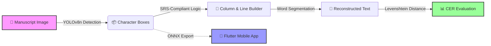
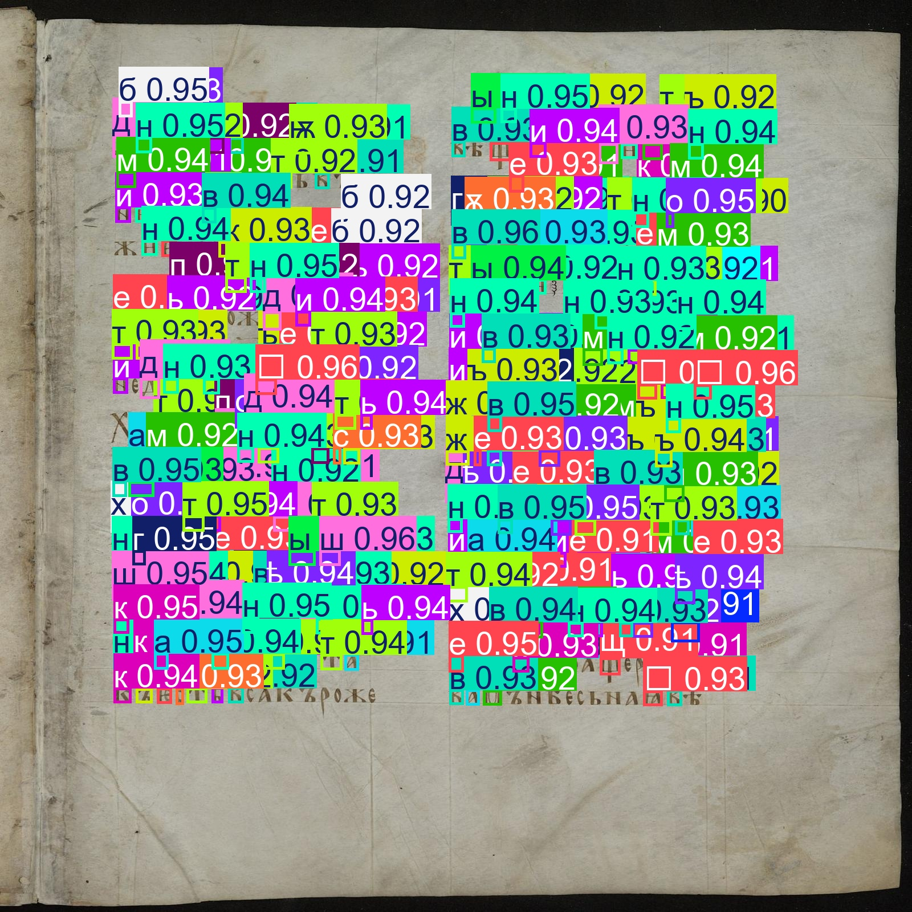
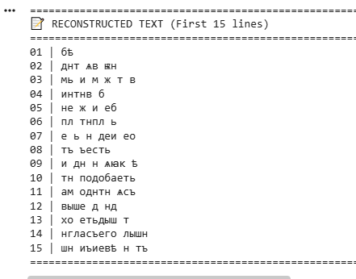
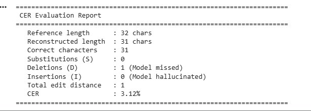

# 📜 Old Church Slavonic OCR System

<p align="center">
  <strong>Bringing Medieval Manuscripts to Life with AI</strong><br>
  <em>End-to-End OCR Pipeline • YOLOv8 • Flutter Ready • SRS-Compliant</em>
</p>

<p align="center">
  <a href="https://github.com/Mulatef-Aldahia/Old-Church-Slavonic-OCR/releases/tag/v1.0.0">
    
  </a>
  <a href="docs/EVALUATION.md">
    
  </a>
  <a href="https://github.com/Mulatef-Aldahia/Old-Church-Slavonic-OCR/actions">
    
  </a>
  <a href="LICENSE">
    
  </a>
  <a href="https://github.com/Mulatef-Aldahia/Old-Church-Slavonic-OCR/issues?q=is%3Aissue+is%3Aclosed">
    
  </a>
</p>

<p align="center">
  
  
  
  
  
</p>

---

## 🌍 Visitors Zone: Overview & Impact

### ❓ Why This Project?
Medieval **Old Church Slavonic (OCS)** manuscripts, written in the ancient **Ustav (Uncial) script**, are cultural treasures. However, commercial OCR engines (like Tesseract or Google Vision) completely fail to process them due to:
- Touching and overlapping glyphs (ligatures).
- Faded ink, stains, and degraded parchment.
- Complex two-column layouts and titlo marks (diacritics).

**Our Solution:** A specialized, end-to-end AI pipeline that detects, reconstructs, and evaluates OCS text with production-ready accuracy.

### 🔄 How It Works (The Pipeline)



### ✨ Key Features at a Glance

| Feature | Description | Status |
|---------|-------------|--------|
| 🎯 **High Accuracy** | Fine-tuned YOLOv8n achieving **mAP50 ≥ 0.87** on real data | ✅ Production |
| 📱 **Mobile Ready** | Dynamic ONNX export verified with ±0 boxes parity check | ✅ Deployed |
| 📐 **Smart Reconstruction** | Adaptive column/line/word builder (no fixed thresholds) | ✅ Verified |
| 📊 **Rigorous Evaluation** | Modular CER with semantic breakdown (Substitutions/Deletions/Insertions) | ✅ Tested |
| 🛡️ **Quality Guardrails** | Automated checks prevent silent class drops during augmentation | ✅ Active |

### 🖼️ Visual Demo

#### 1. Character Detection
<p align="center">
  
  <br>
  <em>Figure 1: YOLOv8n detecting individual OCS characters on a real manuscript page.</em>
</p>

#### 2. Text Reconstruction
<p align="center">
  
  <br>
  <em>Figure 2: Output of the column-aware line/word builder.</em>
</p>

#### 3. CER Evaluation
<p align="center">
  
  <br>
  <em>Figure 3: Semantic CER evaluation showing detailed error breakdown.</em>
</p>

---

## 💻 Developer Hub: Quick Start & Architecture

### 🛠️ Prerequisites
- **Python:** 3.10 or higher
- **Git:** For version control
- **Hardware:** CUDA-capable GPU (Recommended for training, optional for CPU inference)

### 📥 Installation
```bash
# 1. Clone the repository
git clone https://github.com/Mulatef-Aldahia/Old-Church-Slavonic-OCR.git
cd Old-Church-Slavonic-OCR

# 2. Create and activate a virtual environment (Recommended)
python -m venv venv
# On Windows:
venv\Scripts\activate
# On macOS/Linux:
source venv/bin/activate

# 3. Install dependencies
pip install -r requirements.txt
```

### 🚀 Quick Start Usage

#### 1. Character Detection (Inference)
```python
from ultralytics import YOLO

# Load the fine-tuned model
model = YOLO('releases/yolov8n_ocs_FINAL_v6.pt') # Or use app/assets/models/oko_model.onnx

# Run prediction on an image
results = model.predict(
    source='path/to/manuscript.jpg',
    imgsz=1280,      # Auto-resizes for high-res manuscripts
    conf=0.25        # Confidence threshold
)

# Visualize and save
results[0].show()
results[0].save(filename='output.jpg')
```

#### 2. Text Reconstruction & CER Evaluation
Reconstruct reading order (Columns → Lines → Words) and evaluate against ground truth:
```bash
python evaluation/column_builder.py \
  --detections results/detections.json \
  --output results/reconstructed.txt \
  --reference data/manual_references/page.txt
```

#### 3. ONNX Export (For Mobile/Flutter Deployment)
```bash
python training/export_onnx.py \
  --weights releases/yolov8n_ocs_FINAL_v6.pt \
  --output app/assets/models/oko_model.onnx \
  --imgsz 320 1280
```

### 📂 Project Structure
```text
Old-Church-Slavonic-OCR/
├── .github/                 # Issue & PR templates (Professional workflow)
├── app/                     # Flutter app (lib/core, assets, ONNX models)
├── data/                    # Dataset configs (real_ocs.yaml)
├── docs/                    # Documentation & figures (SRS, Cards, Logs)
├── evaluation/              # CER metric & Column/Line builder scripts
├── notebooks/               # 5 Reproducible Colab notebooks (01 to 05)
├── releases/                # Release artifacts documentation
├── results/                 # Evaluation outputs (per_class_ap_test.csv)
├── training/                # Pre-training, fine-tuning, export, guardrails
├── .gitignore
├── AI_Log.md
├── CHANGELOG.md
├── LICENSE
├── README.md
└── requirements.txt
```

### 🔄 Development Workflow
We follow a strict, professional GitFlow for all contributions:
1. **Issue:** Create or pick an issue from the Project Board.
2. **Branch:** Create a feature branch (`git checkout -b type/issue-N-desc`).
3. **Commit:** Make atomic, descriptive commits.
4. **PR:** Open a Pull Request using the provided `.github/PULL_REQUEST_TEMPLATE.md`.
5. **Merge:** Code review → Merge to `main` → Close Issue.

---

## 🎓 Academic Corner: Performance & Citation

### 📊 Key Metrics (Test Split: 22 pages / 8,982 boxes)
| Metric | Value | Target | Status |
|--------|-------|--------|--------|
| **mAP50** | **0.8714** | ≥ 0.85 | ✅ Exceeded |
| **Precision** | 0.9113 | — | ✅ Low FP |
| **Recall** | 0.8613 | — | ✅ High |
| **Inference Speed** | ~79 ms/image | < 100 ms | ✅ Real-time |

### 📄 Citation
If you use this project in your research, please cite:
```bibtex
@software{ocs_ocr_2026,
  author = {Aldahia, Mulatef},
  title = {Old Church Slavonic OCR System},
  year = {2026},
  url = {https://github.com/Mulatef-Aldahia/Old-Church-Slavonic-OCR},
  version = {1.0.0}
}
```

---

## 📚 Documentation & Links
- 📋 [System Requirements Specification](docs/SRS.md)
- 📊 [Detailed Evaluation Report](docs/EVALUATION.md)
- 🗂️ [Dataset Card](docs/DATASET_CARD.md)
- 🤖 [Model Card](docs/MODEL_CARD.md)
- 🎨 [Synthetic Generation Guide](docs/SYNTHETIC_GENERATION.md)
- 📝 [Development Log](docs/DEV_LOG.md)
- 📜 [Changelog](CHANGELOG.md)
- 🤖 [AI Usage Log](AI_Log.md)

---

<p align="center">
  <strong>Made with ❤️ for Digital Heritage Preservation</strong><br>
  <em>Old Church Slavonic OCR System • v1.0.0 • October 2026</em>
</p>
```